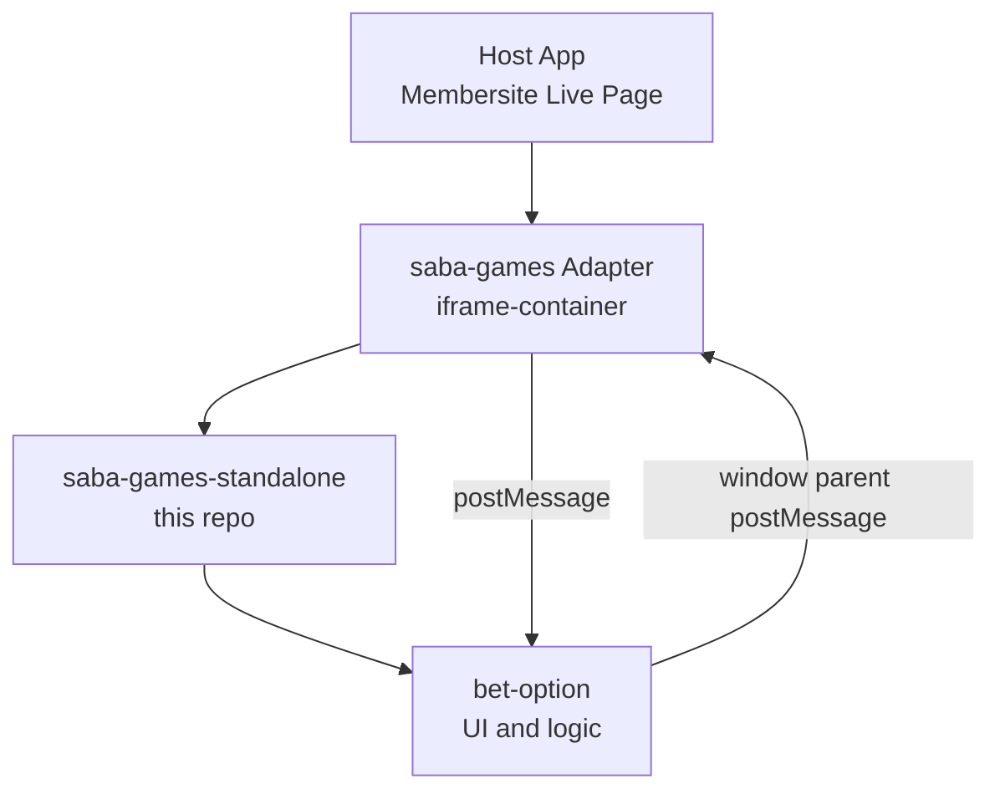

# Saba Games Standalone Architecture

## Overview

@saba-games-standalone is a self-contained game client designed to be embedded as an iframe in host applications (such as the Membersite Live Page). It exposes the full game UI and logic, and communicates with the host via cross-domain messaging.

This repository is intended to be deployed independently and integrated via iframe, allowing for clear separation of concerns, independent deployment, and secure communication.

---

## Repository Structure

-   `src/` — Main source code for the standalone game client
-   `src/_shared/components/bet-option/` — Core betting UI and logic
-   `src/_shared/utils/window-message-util.ts` — Utilities for cross-window messaging
-   `webpack.config.js` — Build configuration
-   `README.md` — Project overview and quick start
-   `ARCHITECTURE.md` — This architecture document

---

## High-Level Diagram



---

## Integration Points

-   **Iframe Embedding:**
    -   The host loads the standalone client via an iframe, e.g.:
        ```html
        <iframe src="https://games.example.com" ... />
        ```
-   **Cross-Domain Messaging:**
    -   Communication between the host and the standalone client is handled via `window.postMessage`.
    -   **Example: Sending a message to the host**
        ```js
        // Inside the iframe (standalone)
        const message = { type: 'BET_PLACED', payload: { amount: 100, choice: 'A' } };
        window.parent.postMessage(message, '*');
        ```
    -   **Example: Receiving a message from the host**
        ```js
        // Inside the iframe (standalone)
        window.addEventListener('message', (event) => {
            if (event.origin !== 'https://expected-host.com') return;
            const { type, payload } = event.data;
            if (type === 'SHOW_CONFIRM_BET') {
                // Show confirm bet dialog
            }
        });
        ```
-   **Events Sent to Host:**
    -   User actions (e.g., placing a bet, confirming a bet) trigger messages to the parent window.
-   **Events Received from Host:**
    -   The standalone client listens for messages from the host to update state, receive configuration, or trigger UI changes.

---

## Communication Protocol

-   **Message Types:**
    -   Define clear message types (e.g., `BET_PLACED`, `SHOW_CONFIRM_BET`, `USER_LOGIN`).

| Type             | Direction     | Payload Example                   | Description              |
| ---------------- | ------------- | --------------------------------- | ------------------------ |
| BET_PLACED       | iframe → host | `{ amount: 100, choice: 'A' }`    | User placed a bet        |
| SHOW_CONFIRM_BET | host → iframe | `{ betId: 123, amount: 100 }`     | Show confirm bet dialog  |
| USER_LOGIN       | host → iframe | `{ userId: 'abc', token: '...' }` | Pass user info to iframe |
| BET_RESULT       | host → iframe | `{ betId: 123, result: 'win' }`   | Notify result of a bet   |
| IFRAME_READY     | iframe → host | `{}`                              | Iframe loaded and ready  |

-   **Security:**
    -   Always validate the origin of incoming messages.
    -   Never trust data from the parent window without validation.
-   **Extensibility:**
    -   New message types can be added as needed for future features.
-   **Versioning:**
    -   Ensure both host and standalone client agree on the protocol version if changes are made.

---

## Development & Testing

-   Develop and test the standalone client independently from the host.
-   Use mock parent windows or test harnesses to simulate host communication.
-   Provide clear documentation for all message types and expected payloads.
-   Ensure robust error handling for unexpected or malformed messages.
-   **Local Development Tips:**
    -   Use `localhost` or a test domain for local iframe integration.
    -   Use browser devtools to inspect postMessage traffic.
    -   Mock host messages using browser console or test scripts.
-   **Integration Testing:**
    -   Create integration tests that simulate host-iframe communication.
    -   Validate that all message types are handled correctly.

---

## Best Practices

-   Keep the standalone client agnostic of the host environment.
-   Document all public events and APIs for cross-domain communication.
-   Use feature flags or configuration messages for host-specific behavior.
-   Maintain clear versioning and changelogs for integration partners.
-   **Error Handling:**
    -   Log unexpected messages and errors for easier debugging.
    -   Fail gracefully if required data is missing or malformed.

---

## Suggestions for Integration

-   Provide example integration code and message contracts for host developers.
-   Coordinate protocol changes with host teams to avoid breaking changes.
-   Automate deployment and versioning for easy updates and rollbacks.
-   **Integration Checklist for Hosts:**
    -   [ ] Use the correct iframe URL and version
    -   [ ] Handle all required message types
    -   [ ] Validate all incoming messages and origins
    -   [ ] Provide user/session/configuration data as needed
    -   [ ] Test integration in staging before production
